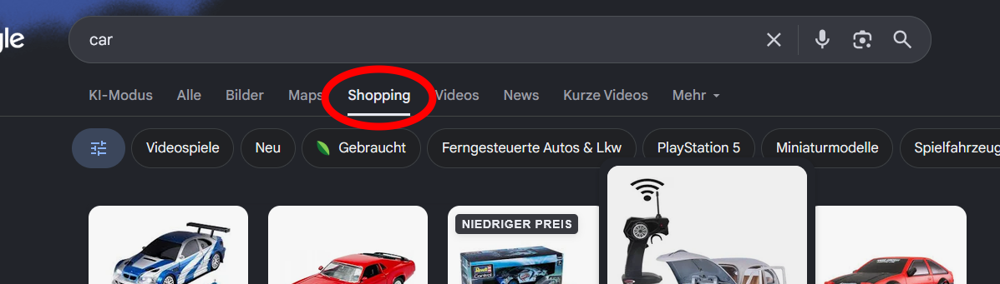

# Restore Google Shopping Tab

This Firefox extension restores the **Shopping** tab in Google search results. It is inspired by the open-source project [Restore Google Maps Button](https://github.com/HeyAnto/restore-google-maps-button).

## Development installation

1. Open Firefox and navigate to `about:debugging`.
2. Select **This Firefox**.
3. Click **Load Temporary Add-on…**.
4. Select this project's `manifest.json` file.
5. Open a Google search. The **Shopping** tab appears next to **Images**.

The extension only processes Google search results on the Google domains listed in the manifest. It can be disabled through the extension popup.

## Note

Google may change the HTML and navigation of its search page at any time. If Google changes its page structure, the DOM selectors in the content script may need to be updated.
